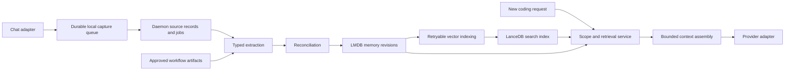

# Cross-session experience memory for coding agents

Status: Proposed specification — not implemented or runtime-qualified  
Date: 13 October 2026  
Project: insrc  
Source snapshot: `af8472a5e93f2280d4a208bfab5974287330dc8d`, with unrelated pending work present  
Initial delivery surface: insrc VS Code chat plugin and local daemon

## 1. Purpose and decision

Give coding agents reliable access to useful experience from earlier sessions: explicit user preferences, project constraints, reviewed engineering decisions, and eventually verified lessons from completed work. Implement a complete **capture → extract → reconcile → retrieve → inject** path using insrc's existing storage and agent integrations.

Retain LMDB as the authoritative record store and LanceDB as a rebuildable retrieval index. Keep source code knowledge, approved workflow artifacts, and experience memory as distinct sources with explicit links. Do not introduce TencentDB Agent Memory as a platform dependency for this first delivery.

The decision is to qualify a narrow native implementation before evaluating a larger external memory platform. It does not assert that the existing memory components are already connected or suitable for production.

Normative language: **MUST** denotes an acceptance requirement; **SHOULD** denotes a recommended default with documented exceptions; **MAY** denotes optional scope. Numerical defaults below are proposed product settings to validate, not measured performance claims.

## 2. Outcomes, scope, and exclusions

### 2.1 Required first outcome

1. In session A, the user says: “For this repository, use Vitest.”
2. The system records the statement and creates an active, repository-scoped preference with source attribution.
3. In a new session B for the same repository, a relevant testing request retrieves that preference and supplies it to the coding agent.
4. The user later says: “We migrated to Node's test runner.” The earlier preference is superseded rather than independently remaining active.
5. A subsequent session retrieves the replacement and can explain its origin.
6. Forgetting the preference immediately excludes it from subsequent memory retrieval, even while index cleanup is pending.

### 2.2 First-release scope

- Local single-user operation through the insrc chat plugin and daemon.
- Explicit user-stated preferences and constraints with bounded repository scope.
- Source-linked memory records; correction, inspection, forget, and capture controls.
- Durable ingestion, extraction retries, index repair, restart recovery, and bounded injection.
- Provenance links to existing approved artifacts where available.
- Existing Claude/Codex native session continuation remains in place.

### 2.3 Deferred scope

- Automatic generalization of arbitrary assistant responses into reusable rules.
- Automatic skill generation, team sharing, global persona inference, and cross-user memory.
- Automatic capture of all conversations in standalone Claude/Codex clients.
- Cross-repository experience transfer unless explicitly requested and separately qualified.
- A general-purpose wiki, replacement code graph, or replacement workflow artifact system.
- Hosted multi-tenant operation and authorization. Repository filters alone are not tenant isolation.

## 3. Current implementation and evidence

This section describes the inspected source, not the proposed end state. File-level links intentionally avoid relying on line numbers that may move.

| Area | Observed implementation | Implication |
| --- | --- | --- |
| Chat capture | [chat-panel.ts](../vscode-plugin/src/chat/chat-panel.ts) stores transcript rows and handles terminal events; [session-store.ts](../vscode-plugin/src/chat/session-store.ts) describes extension-owned session files | A local transcript exists, but there is no verified automatic bridge to semantic experience memory |
| Native continuity | [cli-adapter.ts](../vscode-plugin/src/chat/cli-adapter.ts) resumes provider sessions | Within-session continuity is separate from cross-session recall |
| Lifecycle | [turn-lifecycle.ts](../vscode-plugin/src/chat/turn-lifecycle.ts) handles leases, completion, replay cursors, and resumed output | Capture must cover replay and recovery, not just a live panel callback |
| Daemon storage | [conversations.ts](../src/db/conversations.ts) persists sessions/turns in LMDB and embeddings in LanceDB | Reusable mechanics exist; vector writes follow LMDB commits |
| Retrieval | `searchTurnsByRepo` and `seedFromPrior` hydrate vector hits from LMDB; [daemon/index.ts](../src/daemon/index.ts) exposes the related IPC methods | Search APIs exist; automatic recall callers were not found in current plugin/MCP/workflow source |
| Extraction | [directives.ts](../src/db/directives.ts) identifies directive-like text with weighted regular expressions | Pattern matching is not sufficient evidence that a statement is durable or authoritative |
| Legacy feedback | [feedback.ts](../src/config/feedback.ts) generalizes feedback through an LLM and selects project/global scope heuristically | Do not reconnect unchanged: removing project detail can destroy applicability |
| Compaction | [compaction.ts](../src/db/compaction.ts) truncates, clusters, deduplicates, archives, and replaces turns | These operations must not be the authoritative memory correction mechanism |
| Historical substrate | [session.ts](../src/daemon/session.ts) documents replacement of the rich agent session; legacy references name an absent `daemon/substrate` module | Old design documents and comments do not establish an active memory pipeline |
| Temporary bullets | [working-memory-bullets.ts](../src/db/lance/working-memory-bullets.ts) provides per-run vector storage; no production callers were found | Temporary analysis facts are not durable cross-session experience |
| Code knowledge | [indexer/index.ts](../src/indexer/index.ts) parses, resolves, embeds, and persists entities | Reuse code retrieval rather than duplicating it in experience memory |
| Engineering artifacts | [workflow/storage.ts](../src/workflow/storage.ts) keeps canonical JSON and rendered documentation | Reviewed artifacts remain the source of truth for engineering decisions |

### 3.1 Concrete gaps to resolve

1. **No complete capture bridge:** current plugin transcripts do not automatically feed the daemon's semantic conversation APIs.
2. **No explicit contradiction lifecycle:** similarity clustering does not decide whether a newer assertion replaces an older rule.
3. **Incomplete retention boundary:** `pruneConversations` removes session rows without cascading to their turns; `searchTurnsByRepo` does not validate the parent session's current validity. Therefore session expiry does not establish turn-recall expiry.
4. **Index recovery gap:** LMDB commits precede vector writes; this path needs durable retry and repair state before it supports reliable memory.
5. **Destructive compaction:** replacement deletes occur before replacement additions. Warm responses are truncated, and archived summaries use shortened user messages. This is unsuitable as the sole store of source evidence.
6. **Silent retrieval failures:** existing vector search wrappers can return an empty array on errors. New memory APIs must distinguish unavailable retrieval from a valid empty result.

### 3.2 Verification limits

The analyzer was exercised and its incomplete results were supplemented with source inspection. Existing conversation/Lance and compaction integration suites were attempted; their processes aborted with `SIGABRT`, including under Node 22, without useful assertion results. The cause was not established. No benchmark, successful integration test result, or production-readiness claim follows from this review.

## 4. Architecture and ownership

The daemon MUST own memory persistence, reconciliation, index maintenance, and eligibility checks. Clients MUST use IPC and MUST NOT open LMDB or LanceDB directly.

The client adapter owns source event capture and delivery, repository binding at event time, user-visible memory controls, and the final provider-request boundary. Durable capture must survive an absent daemon or a closed panel.

A proposed `src/daemon/memory/` module SHOULD contain small behavioral services for capture, extraction, reconciliation, retrieval, and maintenance. Storage adapters SHOULD live with the existing database modules. Exact paths are implementation choices; naming an absent module here does not restore the former substrate.

All model access MUST use insrc's existing provider abstractions and model-role policy. Embeddings remain local. Cloud inference, when required, uses the existing CLI providers; no direct cloud REST provider is introduced. Provider calls MUST follow the repository's sequential-execution convention.

## 5. Data contracts

### 5.1 Captured source

Each source record MUST contain:

- Stable source/event ID and payload hash.
- Bound registered repository identity and path-at-capture; never infer scope later from the currently open folder.
- insrc session ID, provider identity, native session ID when available, turn ID, generation, and event sequence.
- Origin: genuine user message, assistant output, tool result, synthetic continuation, or approved artifact reference.
- Terminal status: completed, failed, cancelled, or interrupted; record partial evidence explicitly.
- Captured content or an authorized durable reference, observation time, and optional commit/worktree identity.
- Redaction state, source retention state, and payload schema version.

Repository identity MUST survive supported path moves through an explicit mapping. Separate clones/worktrees MUST not be treated as the same memory scope merely because their folder names match.

Source records are immutable except for lifecycle metadata and policy-directed deletion. A changed payload with the same event ID MUST produce a conflict, not silently overwrite the original.

### 5.2 Memory revision

Each revision MUST contain:

- `memoryId`, immutable `revisionId`, predecessor revision, and monotonically increasing revision number.
- Kind: `preference`, `constraint`, `decision`, or `lesson`. First release activates only explicit preferences/constraints and qualified artifact references.
- Scope: repository plus optional narrower path, language, tool, branch/commit applicability, or task context.
- Canonical fact key, subject, assertion text/value, and applicability conditions.
- Source references including source revision/hash and relevant span or artifact section.
- Authority class: explicit user assertion, approved artifact, or inferred candidate.
- Status: `candidate`, `active`, `conflicted`, `superseded`, `expired`, or `deleted`.
- Valid-from/valid-until where known, creation time, and last validation time.
- Supersession/contradiction relationships and reconciliation reason.
- Extractor/prompt/schema versions and optional confidence score.

Confidence MUST NOT override source authority or establish truth. Memory revision history MUST preserve why a record changed. Unrelated assertions MUST NOT share a fact key just because their embeddings are close.

### 5.3 Index and delivery records

Maintain durable jobs keyed by memory revision, embedding model/version, and projection schema. Job state MUST distinguish pending, running, succeeded, retryable failure, and terminal failure.

Maintain delivery receipts identifying session, turn, retrieval ID, memory revisions, context hash, and dispatch outcome. A prepared bundle is not proof that a provider received it. Receipts enable deduplication and inspection; they MUST NOT expose unrestricted source payloads in diagnostic logs.

## 6. Capture requirements

- Persist source events to a local queue before acknowledging capture success. Daemon acceptance MUST be idempotent.
- Use stable `(adapter, session, turn, generation, event)` identity rather than timestamps alone.
- Replay after reload, reconnect, or daemon restart MUST not duplicate sources or extraction jobs.
- Capture MUST work while the panel is detached. A later recovery pass must discover unacknowledged durable events.
- Treat permission-grant reruns, selection continuations, and other client-generated messages as synthetic. They MUST NOT become user preferences.
- Partial or failed turns MAY be retained as evidence, but MUST NOT be promoted as successful lessons.
- Tool results and assistant assertions are untrusted evidence, not durable instructions by default.
- Explicit user preferences MAY be captured even when the surrounding coding operation fails, provided their source and origin are independently established.
- Do not automatically read attachment bodies, secrets, or arbitrary tool output for memory. Admission and redaction rules must bound eligible content.
- A user can disable new capture per repository. Disabling capture and forgetting existing memory are distinct operations.

## 7. Extraction and reconciliation

### 7.1 Extraction

An asynchronous extractor consumes admitted sources and emits schema-validated candidates. Its idempotency key includes source ID/hash and extractor version. Reprocessing MUST retain lineage without duplicating active facts.

The extractor MUST preserve qualifiers such as “for this repository,” “until migration completes,” and “for integration tests only.” It MUST NOT remove paths or project names when these define applicability.

For the first release, recognize explicit durable assertions and reject or retain as candidates casual suggestions, quoted text, hypothetical examples, negative examples, and instructions embedded in retrieved documents. Do not infer global preferences from an absence of project-specific words.

Extraction failure MUST be visible and retryable without blocking the coding turn. Missing evidence produces no active memory rather than a fabricated generalization.

### 7.2 Reconciliation rules

| Situation | Required outcome |
| --- | --- |
| Same assertion, same scope, additional independent source | Link supporting evidence; avoid a duplicate active fact |
| Explicit correction of the same fact | Create a new revision and supersede the previous revision atomically |
| Two statements with different conditions | Preserve separate scoped assertions |
| Ambiguous conflicting assertions | Mark affected records conflicted and withhold prescriptive injection until resolved |
| Inferred candidate conflicts with explicit user statement | Do not replace the explicit statement |
| User statement conflicts with an approved project artifact | Surface the conflict; do not amend or approve the artifact through memory |
| Scope broadened from project to global | Require explicit user action; first-release global scope remains unsupported |
| Expired/deleted source | Invalidate dependent memory eligibility according to provenance policy |

Similarity is a candidate-discovery mechanism only. Reconciliation MUST check semantic meaning, applicability, authority, and chronology. “Most recent wins” applies only to an established correction within the same fact scope, not all similar text.

Use revision guards for concurrent corrections. A reconciliation transaction MUST commit the new revision, prior-status transition, lineage, and index job together in LMDB. A stale expected revision produces a conflict to retry or resolve.

## 8. Retrieval and injection

### 8.1 Retrieval

The daemon resolves repository and narrower applicability from trusted invocation context. Caller-supplied labels are hints, not an authorization mechanism for future hosted deployments.

Use exact fact/scope matches and semantic candidates as appropriate. After search, hydrate every hit from LMDB and recheck current revision, status, scope, source validity, and expiry. Stale vectors MUST never make a superseded/deleted record eligible.

Return one of `ready`, `empty`, `unavailable`, or `partial`, with reasons and provenance. A vector failure MUST NOT masquerade as an empty corpus. Exact retrieval MAY provide a documented degraded result when semantic retrieval is unavailable.

Start with a proposed maximum of eight memories and 1,500 estimated tokens per request, adjustable after evaluation. Mandatory relevance and validity checks take precedence over filling the budget. Whole qualified records should be selected or omitted; do not truncate away applicability conditions.

### 8.2 Injection

Assemble a separate, clearly marked “Relevant prior experience” section containing the assertion, scope, source reference, and revision. It MUST be presented as contextual evidence subordinate to current user instructions and applicable repository instructions.

The stored user transcript MUST remain the user's original message. Persist injected context as a separate delivery record. Do not concatenate memory into historical user messages or present it as a newly issued user instruction.

Retrieve at the start of a new session and at relevant scope/topic or memory-revision changes. In resumed native sessions, track delivered revisions so unchanged facts are not appended every turn. When a correction matters, send a concise replacement notice identifying the superseded revision.

A retrieval failure SHOULD allow the coding request to proceed with visible degraded-memory status. It MUST NOT silently fall back to an unchecked cached bundle. Provider dispatch MUST validate that the prepared bundle is still valid at dispatch; define the dispatch boundary as the point of no further retroactive removal guarantee.

Initial injection belongs in the chat request composition layer before the adapter runs. Standalone MCP clients need a separate documented capability for context acquisition and capture. Using existing analyze tools alone MUST NOT be represented as complete experience-memory integration.

## 9. Persistence, retention, and forgetting

- Treat vectors as disposable projections. Rebuild them from authoritative eligible revisions without reviving deleted records.
- Commit memory changes and durable projection jobs together; process vector updates asynchronously with bounded retries and repair scans.
- Reconciliation MUST not depend on the legacy destructive conversation-compaction algorithm.
- Keep source retention and memory validity explicit. First release SHOULD expire a derived memory when its required source is removed; a separately confirmed standalone user assertion is a new source, not a silent exemption.
- Persist tombstones before asynchronous cleanup. Retrieval checks them immediately.
- Define forget targets separately: one memory/fact, a source conversation and its derived memories, or all memory for a repository.
- A forget operation MUST account for revisions, vectors, context caches, queued jobs, and derived records. Replay and rebuild MUST respect deletion watermarks.
- A backup restore MUST apply current deletion records before serving memory. Document the backup-retention boundary and offline-backup deletion limitations.
- Fix or isolate legacy session pruning before exposing its turns to the new retrieval path. Parent-session deletion alone is insufficient.
- Memory removal cannot erase content already transmitted to a provider's native session. The UI MUST identify this limitation and support starting a fresh session when needed. Provider-side history deletion is a separate capability, not implied by local forget.

## 10. Proposed service interfaces and user controls

These are conceptual contracts, not currently registered IPC/MCP methods. Implementation must follow the repository's workflow, schema, and mirrored-client-contract rules.

| Operation | Input | Result |
| --- | --- | --- |
| `memory.capture` | Bound scope, source events, idempotency IDs | Accepted IDs, durable receipt, conflicts |
| `memory.retrieve` | Bound scope, task/query, budget, already-delivered revisions | Status, eligible memories, sources, retrieval ID |
| `memory.list` / `memory.inspect` | Scope, filters, memory ID | Current status, revision history, sources, explanation |
| `memory.correct` | Memory ID, expected revision, explicit replacement | New revision or revision conflict |
| `memory.forget` | Target and expected scope | Immediate exclusion receipt and cleanup state |
| `memory.recordDelivery` | Retrieval ID, turn identity, dispatch outcome | Idempotent delivery receipt |
| `memory.status` | Scope | Capture/index backlog, failures, last successful processing |

Input validation MUST reject malformed IDs, unregistered scopes, oversized content, and inconsistent source/revision references. Do not add public tool exposure until client identity and capability semantics are specified.

The user surface MUST show what was remembered, why it applies, its source, and whether it is pending, active, conflicted, or superseded. Provide correction, forget, capture controls, and a per-turn view of injected memories. Do not require users to inspect raw database records.

## 11. Qualification and acceptance criteria

### 11.1 Deterministic acceptance scenarios

| ID | Scenario | Pass condition |
| --- | --- | --- |
| MEM-01 | Explicit preference in session A, relevant task in session B | Correct scoped fact is delivered with a resolvable source |
| MEM-02 | Replay the same capture event after restart | One source and one effective extraction result |
| MEM-03 | Same event ID with different payload | Explicit conflict; original evidence preserved |
| MEM-04 | Explicit correction | Old revision is no longer eligible; replacement is used |
| MEM-05 | Ambiguous contradiction | No conflicting instruction is silently selected |
| MEM-06 | Similar content in two repositories | No cross-repository recall |
| MEM-07 | Repository path changes or worktree switches | Scope follows explicit identity rules; no accidental widening |
| MEM-08 | Forget while vector cleanup is delayed | All subsequent retrieval excludes affected records |
| MEM-09 | Source expiry/session pruning | Derived memory cannot bypass retention through turn search |
| MEM-10 | Crash after LMDB commit but before vector write | Pending job is retried and indexing converges |
| MEM-11 | Daemon unavailable, panel closed, later restart | Durable events are captured once when service returns |
| MEM-12 | Synthetic permission continuation or quoted instruction | Not promoted into a user preference |
| MEM-13 | Native session resumed repeatedly | Unchanged memory is not repeatedly injected |
| MEM-14 | Correction or forget after prior injection | Future delivery is correct; prior-provider-context limitation is surfaced |
| MEM-15 | Vector failure | Returns unavailable/partial with cause; no false empty result |
| MEM-16 | Stale index revision | Authoritative hydration rejects stale memory |
| MEM-17 | Oversized retrieval result | Budget holds without stripping qualifying conditions |
| MEM-18 | Backup restore or source replay after deletion | Deleted memories are not resurrected |
| MEM-19 | Concurrent corrections | Revision guards prevent lost updates |
| MEM-20 | Memory suggests a conflicting action | Current instructions and workflow approval boundaries remain effective |

Test actual LMDB/Lance integrations with isolated temporary stores, fake clocks, deterministic embeddings, injected failures, and process restart where required. Add provider-adapter contract tests for request assembly and replay. Existing tests are reusable evidence only after their abort is diagnosed and they pass.

### 11.2 Behavioral evaluation

Compare the same coding-task sequences under: (A) no cross-session experience memory, (B) existing code/artifact retrieval, and (C) code/artifact retrieval plus proposed experience memory. Keep provider/model configuration and repository snapshots fixed; reset sessions between conditions.

Include repeated conventions, reversed decisions, similar-but-unrelated projects, stale branch-specific facts, failed attempts, injected instructions in tool output, and questions whose correct answer is that no applicable memory exists. Expected answers must be established independently of extractor output.

Measure task success, correct memory use, unsupported assertions, stale/conflicting-memory use, source accuracy, user corrections, added latency, extraction/injection tokens, and total inference cost. Report sample sizes, repeated-run variability, and complete configurations. Accuracy is the primary optimization target; cost reductions do not justify worse correctness.

Release requires every deterministic acceptance scenario to pass and a predeclared behavioral evaluation showing useful cross-session benefit without a material correctness regression. Zero observed leakage/deletion failures in the qualification suite is mandatory but is not proof of universal safety. Set quantitative behavioral thresholds before running the release evaluation, not after observing its results.

## 12. Delivery sequence and rollout

1. **Contracts and baseline:** finalize source, memory, lifecycle, and scope contracts; diagnose the aborting integration tests; record baseline evaluation results. Enter implementation through insrc's normal tracked workflow.
2. **Durable capture:** implement adapter events, local delivery queue, daemon admission, idempotency, and recovery. Capture-only mode; no automatic injection.
3. **Explicit memory lifecycle:** implement typed extraction, revisions, reconciliation, source inspection, correction, and forget. Validate using deterministic fixtures.
4. **Retrieval qualification:** implement eligible-record hydration, indexing retries, budgets, status reporting, and repair/rebuild. Run retrieval in observation mode without changing coding prompts.
5. **Opt-in injection:** enable bounded context for a small local cohort; compare against the baseline and expose per-turn delivery records.
6. **Broader adapters and inferred lessons:** only after the first loop passes; each client must prove its own capture, replay, scope, and injection behavior.

Use independent controls for capture, extraction, retrieval, and injection. Disabling injection MUST stop future delivery immediately without deleting evidence. Disabling extraction MUST retain queued-job status. Rollback MUST preserve source records and understood revisions; an older binary must not silently reinterpret a newer memory schema.

No bulk import of existing transcripts by default. Historical import requires explicit repository mapping, source-origin checks, retention admission, and deduplication. Do not promote all existing directive or compacted rows into active memories.

## 13. Risks and decisions required before implementation

| Decision | Recommended initial position |
| --- | --- |
| Source retention duration | Set an explicit configurable policy; do not inherit conversation TTL accidentally |
| Explicit assertion activation | Activate only validated, unambiguous repository-scoped user assertions; expose immediate correction/forget |
| Inferred lessons | Candidate-only until a separate evidence and review policy is qualified |
| Repository identity across clones | Use registered identity plus explicit equivalence; no folder-name heuristics |
| Branch-specific applicability | Preserve commit/branch qualifiers; do not generalize automatically |
| Extraction model and budget | Follow current role policy; evaluate correctness before choosing cheaper inference |
| Standalone agent support | Define a separate adapter contract; no claim of automatic capture through MCP alone |
| Legacy compaction | Keep away from authoritative memory evidence until redesigned and qualified |
| TencentDB integration | Revisit only against the same acceptance suite if native lifecycle cost outweighs reuse benefits |

## 14. Definition of done

The first release is complete when a real new coding-agent session can use a source-backed explicit preference from a prior session; a correction reliably replaces it; forgetting reliably blocks future recall; duplicate delivery and restarts do not change the result; the user can inspect what was injected; and the acceptance and behavioral evaluations pass with recorded evidence.

Storage APIs, a vector table, passing isolated unit tests, or a prompt demo alone do not meet this definition.
