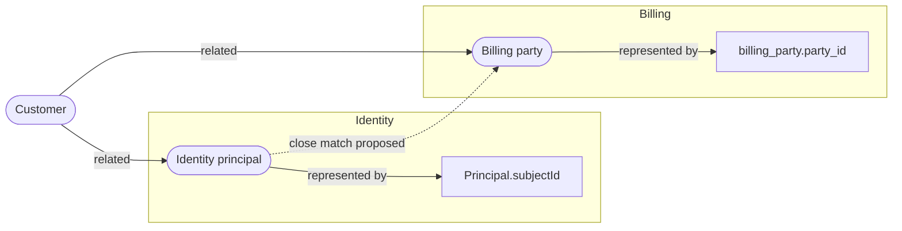

# insrc Domain Ontology Builder PRD

Status: Draft for discussion. Not approved for implementation.

Date: 23 October 2026

## Product intent

Help engineers and their AI assistants understand what a platform represents across fragmented services, schemas, APIs, events, and documentation. Build a persistent, evidence-backed domain model above insrc's code index, then use it to explain business concepts, investigate changes, and inform design and review.

The core asset is a versioned map connecting domain concepts to their concrete representations. A customer may appear as a CRM contact, identity principal, billing party, and warehouse dimension. These representations can overlap without being interchangeable. The product must preserve those distinctions and expose disagreement rather than forcing everything into one universal schema.

The user has confirmed that ontology construction must reuse insrc's existing data and schema analysis tools. The ontology layer orchestrates and interprets that evidence alongside the code and document index; it must not build a parallel data analyzer or connector stack. The user has also confirmed an automatic, repository-scoped ontology builder: registration and indexed repository updates generate proposed ontology revisions without requiring a manual domain-build request. The user selected building an insrc-owned ontology framework on 23 October 2026. Release boundaries, focused library choices, and success targets below remain proposals for discussion.

## Problem and users

Code indexes explain implementation structure. Complex platforms also require semantic understanding: which names refer to the same business concept, where meanings differ, how identities are mapped, and which rules apply in each context. That understanding is usually spread across code, database definitions, contracts, documents, and people's explanations.

Primary users are engineers investigating unfamiliar systems, architects planning changes across services, and domain owners reviewing proposed interpretations. AI assistants consume the same model when answering questions or driving insrc's engineering workflow.

The initial product should answer questions such as:

- Where is customer identity represented, and which identifiers connect those representations?
- Do billing and authorization mean the same thing by an active subscription?
- Which services, fields, events, and documented rules may be affected if orders become tenant-scoped?
- Which parts of this answer are confirmed, inferred, disputed, or no longer supported by current sources?

## Goals and boundaries

The first release should create and maintain a useful model of one business domain across two or three services. It should connect concepts to source evidence, support explicit review, preserve local terminology, and improve a small set of domain questions and change investigations.

It is not a replacement for the code graph, a master data management system, an operational data warehouse, or a mechanism for automatically merging customer records. Ontology describes meaning; lineage records movement and transformation. The product links the two but does not treat semantic similarity as evidence of data flow.

Full OWL reasoning, arbitrary user-authored inference programs, enterprise-wide automatic discovery, production record ingestion, and a separate collaborative ontology editor are outside the initial release. New general-purpose database connectors and complete support for every API or event schema format are also outside it.

## Main user journeys

1. **Register and update a repository.** Successful `repo.add` registration queues an initial ontology build after the required code and document indexing settles. Subsequent indexed changes queue incremental proposals for affected repo entities. A repository with no data connections still receives a code-, contract-, and document-backed proposal with explicit evidence gaps. Generation does not activate assertions.
2. **Build a domain map.** A user selects a business domain, registered repositories, and eligible registered data connections. insrc uses its existing data analysis tools to discover objects, describe schemas, and investigate candidate relationships, joins the results to code and document evidence, then presents proposed concepts and mappings with explicit coverage gaps.
3. **Review meaning.** A domain owner accepts, revises, rejects, or disputes individual definitions and mappings. The interface shows the evidence and the consequences of accepting an equivalence. Accepted assertions become available to normal analysis.
4. **Ask a domain question.** An engineer asks where an order or entitlement is represented. insrc returns concepts, context-specific definitions, concrete representations, and source references. It distinguishes confirmed knowledge from exploratory suggestions.
5. **Investigate a change.** An engineer proposes a business change. insrc combines accepted mappings with code dependencies and observed lineage to produce possible impact paths, including their evidence and gaps. It does not claim exhaustive impact from partial coverage.
6. **Refresh after source changes.** Changed code, contracts, documentation, or schema snapshots identify affected assertions. insrc proposes a revision and flags stale evidence without silently replacing reviewed meaning.

## Product model

### Three connected layers

| Layer | Contents | Authority |
| --- | --- | --- |
| Observed structures | Code symbols, document sections, schema objects, contract fields, endpoints, and observed producer or consumer relationships. | The identified source revision or metadata snapshot. |
| Domain concepts | Definitions, preferred names, aliases, contextual variants, business relationships, lifecycle states, and constraints. | Explicitly reviewed assertions within a declared domain and context. |
| Mappings and evidence | Assertions connecting concepts to representations or to other concepts, with supporting and opposing evidence. | The assertion's review state, provenance, and freshness. |

Ontology assertions must remain distinct from parser-produced code edges. An LLM proposal must never become indistinguishable from a deterministic observation.

### Concepts and context

Each concept has a stable identifier, domain namespace, definition, labels, bounded context, version history, and optional owner. A label change does not change its identity. Renames, merges, splits, and retirement preserve redirects or explicit historical relationships; they must not discard prior references.

Two services may legitimately define different variants of Customer. A model can express a common broader concept while preserving the service-specific concepts. Domain membership does not grant access to additional repositories or data connections.

### Relationships and mappings

The initial vocabulary should distinguish:

- Concept relationships: broader, narrower, related, part of, and domain-specific relationships with explicit definitions.
- Concept mappings: close match, exact match within a declared scope, and explicit non-equivalence.
- Representation mappings: represented by, identifier field, state encoded by, and implements a constraint.
- Lineage relationships: derived from or transformed into, only when supported by an observed or reviewed transformation.

Concept-to-concept mappings and concept-to-code mappings have different semantics. Use SKOS mapping properties only for suitable concept mappings. Use an insrc vocabulary to link concepts to code symbols, tables, and contract fields. Do not equate a table or class with a business concept through `owl:sameAs`.

An exact concept match is stronger than a similar name or embedding match. It requires explicit review of definitions, identity scope, lifecycle, and known differences. The initial product must not automatically propagate exact matches through a chain of mappings. In particular, SKOS `exactMatch` is transitive; scoped or qualified insrc assertions must not be exported as unqualified SKOS triples that imply a broader equivalence. [SKOS reference](https://www.w3.org/TR/skos-reference/)

### Assertion provenance and state

An assertion records its subject, relationship, object, context, rationale, supporting and contradicting evidence, source revisions, extraction method, and reviewer history. Model-produced proposals also record the provider and model used. A retrieval score ranks candidates; it is not a calibrated probability that a mapping is true.

Review state and freshness are separate dimensions. Proposed, accepted, rejected, disputed, and superseded describe review state. Current, stale, missing-source, and unknown describe freshness. A source change can make an accepted assertion stale without erasing its history. Human-authored definitions may cite a recorded domain decision; they must not be described as observed code facts.

Use provenance concepts compatible with PROV-O for derivation and attribution, while retaining insrc-specific review metadata. Provenance describes how an assertion arose; it does not establish its truth. [PROV-O](https://www.w3.org/TR/prov-o/)

### Entity metadata and categorization

Users can assign and revise domain, module/subsystem, multiple categories, and optional tags on concepts and technical representations. Keep these dimensions separate from entity kind, repository membership and bounded context. Domain/module references and category identifiers should remain stable through label renames; an entity may have multiple categories, explicit unclassified values, and context-qualified memberships where needed. Vocabulary ownership and any exclusive or hierarchical rules must be defined rather than inferred from labels.

The builder can propose metadata from manifests, paths, namespaces, schemas, dependency structure, documents and existing reviewed classifications. Every suggested assignment records evidence, extraction method, provider/model when used, source version and rationale. Deterministic source facts remain distinct from inferred business classifications; a directory name is a clue, not proof of domain meaning. Suggestion ranking is not a calibrated confidence probability.

Users can accept a suggestion into a draft, override it manually, reject it, and review/activate the resulting change. Preserve previous values, provenance and reviewer history. Automatic builds/refreshes cannot overwrite reviewed assignments or reintroduce rejected suggestions silently; changed evidence marks assignments stale or proposes alternatives. Manual overrides retain their authority until explicitly revised. Category/domain/module filters and grouping use the selected revision and explicit review-state scope; proposed classifications never silently enter accepted search facets. Support previewable batch assignment/inference for an explicitly selected result set with matched/selected counts and individual conflicts; filter changes cannot silently expand the batch.

The mocks demonstrate per-entity manual edits, fixture-only inference, reject/use-as-draft and explicit review/activation, plus metadata search/filtering. Batch actions and taxonomy administration are requirements for design, not implemented prototype controls.

## Functional requirements

| ID | Requirement | Acceptance behavior |
| --- | --- | --- |
| OB01 | Select and inventory sources. | A run records repositories, source revisions, metadata snapshots, unsupported formats, exclusions, failures, and retrieval limits. |
| OB02 | Discover candidate concepts. | Proposals include definitions, bounded context, source references, alternatives, and reasons; names alone cannot establish equivalence. |
| OB03 | Map concrete representations. | A mapping identifies a specific source object and revision, its relationship to the concept, and known semantic differences. |
| OB04 | Review assertions. | Users can accept, revise, reject, dispute, and supersede assertions individually or in an explicit batch. No model can approve its own proposal. |
| OB05 | Validate the model. | Identity, reference, context, provenance, and supported shape constraints are checked before activation. Failure leaves the prior active version intact. |
| OB06 | Answer domain questions. | Default answers use accepted, current assertions and show evidence and coverage limits. Exploratory mode clearly separates proposals, disputes, and stale assertions. |
| OB07 | Explain possible impact. | Each reported path distinguishes semantic mapping, structural dependency, and lineage. Unsupported jumps and scope exclusions are visible. |
| OB08 | Refresh incrementally. | Changed or removed evidence identifies affected assertions and derived results. Refresh cannot reactivate rejected mappings or overwrite accepted meaning silently. |
| OB09 | Preserve history and recover. | Version comparison, rollback, merge and split history, and restart recovery preserve stable identities and review decisions. |
| OB10 | Exchange ontology data. | Export and import support a documented RDF profile and preserve assertion identity, provenance, state, and context. Unsupported constructs produce diagnostics rather than silent loss. |
| OB11 | Inform engineering work. | Analysis, design, and review can retrieve relevant accepted concepts and constraints with an ontology revision reference. Conflicts are surfaced rather than automatically resolved. |
| OB12 | Reuse the existing data analysis surface. | Discovery, schema inspection, profiling, lineage probes, and supported drift checks use the existing daemon tool or analysis runtime contracts. No ontology-specific connector, SQL executor, or alternative credential store duplicates them. |
| OB13 | Preserve tool evidence faithfully. | Each consumed result retains its tool or runtime identifier, run reference, connection and target, normalized inputs, capture time, source provenance, relevant revision or fingerprint, limits, sampling basis, and errors. |
| OB14 | Investigate structural candidates before semantic promotion. | A proposed identifier or relationship cites available PK/FK metadata and targeted existing profiling results, or states why those checks were unsupported or not run. Heuristic lineage and sampled shapes never become confirmed semantic facts automatically. |
| OB15 | Inspect the complete captured entity model. | Selecting an entity retains the summary inspector and offers a full-model view with all captured attributes, including non-key and nested fields, types, presence or nullability, defaults, constraints, relationships, and source provenance. Concept representations can be selected independently. Search reports visible versus captured counts; sampling, truncation, unsupported metadata, and freshness remain visible. |
| OB20 | Assign and infer entity metadata. | Domain, module/subsystem, categories and tags support manual drafts and evidence-backed inferred proposals, explicit review/activation, override and rejection history. Scoped metadata search/grouping and previewable batch actions preserve stable taxonomy identities and never overwrite reviewed values during refresh. |
| OB19 | Navigate large ontology sets. | Scoped indexed search, facets, lazy groups, bounded result pages and focused graph expansion preserve selection/history and show coverage counts. Full-model search spans all captured attributes, with bounded rendering. Stale search responses and whole-project graph rendering cannot overwhelm the viewer. |
| OB16 | Build automatically on registration. | A successfully registered repository schedules a durable initial build after its relevant code/document index work settles. The result is a proposed ontology for eligible repo entities, even with no datastore connection or manually selected business domain. Repeated registration of unchanged input cannot duplicate a build or proposal. |
| OB17 | Rebuild incrementally on indexed updates. | Added, changed, renamed, and deleted indexed entities, contracts, and documents schedule affected evidence/mapping refresh. Runs pin source versions, coalesce duplicate events, and preserve accepted definitions, rejected mappings, and user drafts. New interpretations remain proposed. |
| OB18 | Operate as a recoverable background builder. | Expose queued, waiting-for-index, building, proposed, partial, failed, canceled, and up-to-date states with input revision/coverage and errors. Serialize per-repo mutation, checkpoint/resume after restart, and supersede obsolete work without publishing an older result over a newer revision. |

| OB21 | Validate an explicit evaluation scope. | Every report identifies revision, source/context/review/freshness scope and profile; proposal-only facts cannot satisfy accepted-state checks. |
| OB22 | Explain validation outcomes. | Per-entity/path findings and pass/fail/unsupported/incomplete/not-checked counts remain visible; required unresolved checks cannot silently pass activation. |
| OB23 | Preview semantic activation consequences. | Persist a base/candidate/evidence-bound change plan with affected assertions, structural and known semantic effects, risk reasons and limits; stale approval cannot activate changed input. |
| OB24 | Protect reviewed meaning. | Explicitly protected definitions/mappings/metadata survive automation and batch edits; conflicts become proposals and protection never hides staleness or contradictions. |
| OB25 | Regress domain competency questions. | Versioned expected claims/abstentions and evidence tests report changed or unsupported answers before relevant activation; changes to expectations require review. Early follow-up. |
| OB26 | Explain derived assertions. | Deterministic derivations identify premises/rules/revisions and invalidate on premise change; LLM suggestions remain distinct and completion limits are disclosed. Early follow-up. |
| OB27 | Preserve supported claims in retrieval. | Bounded projections retain derivation support or report lost/unknown/not-checked and expand or abstain within scope. Later scope. |

Initial evidence inputs are indexed code and documents, selected repository contract files, and metadata from supported registered data connections. Contract extraction is a new capability where existing parsers do not provide the necessary detail. Unsupported sources must be declared, not filled in by model inference.

Start with schemas and metadata, then use targeted existing data analysis where a domain question needs more evidence. Profiling or shape inference can inspect values through the existing tools and access policies; the ontology does not become a store of production rows. Retain structural findings and aggregate results, and exclude unnecessary raw values from persisted ontology evidence and model context. A schema inferred by a driver remains marked inferred. Live schema snapshots record capture time and connection identity and do not pretend to be immutable repository revisions.

## Reuse of existing data and schema analysis

Ontology discovery must consume the existing tools' structured outputs and their failure and completeness information. Tools and planner runtimes are alternative existing entry points into the same capabilities, not layers that must both be invoked for every object. Choose the appropriate registered contract and reuse current daemon dispatch, driver capabilities, connection scoping, and access checks.

| Ontology construction step | Existing capability | Interpretation and limits |
| --- | --- | --- |
| Discover registered sources | `db_list_connections`; `data.discovery.connections` runtime | Enumerate the connections available within the selected repository scope. Registration does not imply every driver supports every probe. |
| Inventory representations | `db_sql_list_tables`, `db_kv_list_namespaces`, `db_file_list_files`; `data.discovery.objects` runtime | Seed tables, namespaces, collections, or file targets. Preserve enumeration limits and unsupported-family diagnostics. |
| Describe structure | `db_sql_describe`, `db_sql_list_indexes`, `db_kv_describe_namespace`, `db_file_describe`; `data.schema.table` runtime where supported | Extract columns or field paths, types, nullability, identifiers, and available PK/FK or index information. The table-schema runtime currently handles RDBMS and supported file drivers; KV uses its own tools. |
| Infer missing shape | `db_kv_sample_shape`, `db_file_sample_shape` | Reuse existing inference for sources without complete declared structure. Describe the sampling basis and retain field frequencies; absence from a sample is not proof that a field does not exist. Some namespace descriptions also sample values. |
| Investigate candidate relationships | `db_sql_anti_join`, `db_sql_functional_dependency`, and relevant `db_sql_aggregate`, `db_sql_distinct`, or file-family profiling tools | Investigate orphaned keys, determinants, state values, and cardinality hypotheses. Check per-driver support. The SQL anti-join is same-connection only; no new cross-source join engine is implied. Full-table results remain specific to their filter, time, and source consistency. |
| Connect data to code | `data_lineage` | Reuse candidate reader, writer, and ambiguous citations. Its current vector retrieval, literal-name filtering, and heuristic classification do not prove complete lineage or an exact transformation. |
| Detect supported drift | `data_schema-drift` | Reuse the existing Prisma expected-schema versus live RDBMS comparison. It does not cover arbitrary static schemas, KV, or file drift. For other sources, compare captured tool-result structure across runs and label the new ontology invalidation behavior separately. |
| Check applicable constraints | `data.adherence.check` runtime | Reuse checks against relevant documented constraints, retaining their evidence and qualifications. Ontology shape validation and semantic review remain separate responsibilities. |

These identifiers are grounded in the [database tool registry](../src/daemon/tools/builtins/db/index.ts), [data tools](../src/daemon/tools/builtins/data/index.ts), and [data analysis runtimes](../src/analyze/runtimes/data/index.ts). The PRD does not prescribe new tool argument shapes; orchestration must use their registered schemas at implementation time.

For example, a Customer domain run discovers a registered billing connection, lists its tables, describes `billing_party`, and records `party_id` and its declared relationships. It uses the existing lineage probe to find candidate code references and retrieves relevant domain documents. If an identity mapping remains ambiguous, it selects a targeted supported profile check. The ontology builder then proposes what those structures mean, with the exact evidence attached. An orphan count of zero supports referential coverage in that snapshot; it does not establish that two concepts are identical or share a lifecycle.

The new product work is evidence orchestration and normalization, domain concepts and contextual mappings, assertion review, versioned storage, invalidation, and retrieval. Schema introspection, database access, shape inference, and supported data probes remain owned by the existing data analysis system. No live database inspection is required merely to read or edit an already captured ontology version.

## Validation, change planning and assurance

### Scoped, explainable validation — first release

Every check is bound to an immutable evaluation manifest: ontology/base revision, repository closure and selected connections, bounded contexts, included review/freshness states, source snapshots, shape/rule profile versions and coverage limits. Scope selection happens before validation, inference, counts or retrieval. Never union accepted, proposed, historical or incompatible contexts implicitly. A required field supplied only by a proposal cannot satisfy an accepted-model constraint. Previewing a candidate means explicitly validating the composed candidate revision, not mixing unrelated proposal graphs.

Return structured findings containing stable finding ID, entity/assertion, attribute/path, constraint, severity, supporting evidence, source revision and suggested correction when available. Report pass, fail, unsupported, incomplete and not-checked separately, with reasons and counts. Unsupported, expired or skipped checks cannot produce a clean all-valid summary; required unresolved checks block activation until resolved or explicitly waived with an attributed reason where policy permits. Warnings remain visible. User feedback cannot silently suppress a failed check. Validation reports distinguish structural validity from semantic truth.

### Semantic activation plans — first release

Before activation, produce a persisted change plan: added/removed/renamed concepts and representations; definition, category and mapping changes; affected assertions, references and constraints; invalidated evidence; and available downstream effects. Distinguish text/structure changes from changed supported conclusions. Show risk explanations and scope/coverage limits rather than only a numeric score. Consequence analysis may be partial in the first release; say which checks did not run. Later competency-question regression results attach to this same plan.

Bind the plan to base/candidate revision hashes, evaluation manifest and validation-profile versions. Approval applies to exactly that plan. A changed base, candidate or relevant evidence invalidates it and requires a fresh preview; activation atomically checks those identities. An assertion patch is an explicit operation set, never interpreted as a complete replacement that deletes omitted assertions. Identity-preserving renames do not create automatic equivalentClass/sameAs/exactMatch bridges from string similarity.

### Protected definitions and metadata — first release

Users can protect reviewed definitions, mappings and domain/module/category assignments. Protection preserves the reviewed value during automatic construction, refresh, import and batch edits; conflicting new evidence generates a visible proposal. Protection does not freeze freshness or hide contradictions: a protected assertion can be stale or unsupported. Deliberate revision/unprotection requires an explicit attributed decision and a new reviewed plan. Keep rejected suggestions and individual batch conflicts visible.

### Competency questions and inference explanations — early follow-up

Maintain versioned domain questions with expected supported claims or abstentions, evidence expectations and evaluation scope. Run a fixed regression set before activating relevant revisions and show added, changed or unsupported answers, lost evidence and uncertainty. Expected results cannot be rewritten automatically to make a candidate pass. The initial baseline is human-reviewed claims/abstentions; an LLM's answer or wording match alone is not an oracle. Policy determines which regressions block activation and how exceptions are recorded.

For each derived assertion or inferred classification, retain premise assertion IDs, source/evaluation revisions, rule/profile version and an explanation of alternatives/conflicts. Keep derivations separate from deterministic observations and human decisions. Distinguish deterministic rule consequences from LLM suggestions; a model rationale is not a proof. Bound inference, detect cycles and report failure to reach completion rather than presenting a partial closure as exhaustive. Retracted premises invalidate dependent derivations. Human semantic approval is still required where applicable.

### Consequence-aware retrieval and certificates — later scope

For structured claims backed by explicit derivations, check that a bounded assistant-context projection retains the needed premises under the declared rule profile. Report supported, lost, unknown or not checked per claim; expand within scope/budgets or abstain when support is lost. High entity/triple coverage alone cannot establish answer preservation. This does not promise a general semantic equivalence test for arbitrary natural-language answers.

Independently checkable reasoning certificates remain optional future scope, limited to an explicitly supported deterministic rule subset and exact input hashes. They are not a first-release dependency or a promise of full OWL reasoning, verified business meaning or correctness of the entire framework. Require a separately justified design and checker evaluation before adoption.

## Building and maintaining the model

The proposed flow is scope selection → existing data and schema analysis → code and document evidence correlation → candidate concepts and mappings → targeted existing probes for unresolved structural questions → assertion drafting → validation → human review → activation. Each probe must answer a specific evidence gap rather than exhaustively profiling every source. Deterministic metadata, sampled inference, and heuristic probes retain their separate evidence classifications; models suggest meaning and explain alternatives. Unsupported or conflicting mappings stay unresolved.

The initial interaction should run through the assistant and daemon, presenting a readable concept map and assertion list. Each concept should show its definition, context, concrete representations, sources, review state, and freshness. A user should be able to inspect a mapping without understanding RDF syntax. A dedicated graphical editor can follow once these interactions prove useful.

Refresh should reuse unchanged evidence and reviewed assertions. It should prioritize the domain being queried and yield to foreground code indexing. Provider calls remain sequential under the existing LLM abstraction. Explicitly record partial completion and allow cancellation and resumption.

### Automatic repository lifecycle

The ontology builder is a daemon-owned background capability alongside indexing. Its default scope is the registered repository's eligible indexed entities and evidence, within existing access boundaries. Domain selection remains an optional refinement and cross-service composition journey; it is not a prerequisite for the initial repository proposal. Inventory all eligible entities, but do not invent a business concept for every symbol: use justified concepts and representation mappings, report unclassified entities and coverage gaps, and preserve technical distinctions.

| Trigger | Builder behavior |
| --- | --- |
| Successful new repository registration | Queue an initial build; wait for relevant code and document indexing to finish or report a settled partial/failed outcome. Never open an unregistered store or silently skip ontology work. |
| Indexed repository update | Debounce/coalesce watcher, pull, reindex, and registration events by effective input version; refresh changed evidence and dependent assertions rather than rebuilding every concept. Code hashes, contract/document versions, extraction profile, and captured schema fingerprints contribute to input identity; Git HEAD alone is insufficient for uncommitted changes. |
| Connection added/updated or a new schema snapshot captured | Enrich the repository proposal using existing supported data analysis. Missing/unreachable connections do not block a code-only proposal; record partial coverage. Connection removal invalidates affected evidence without deleting review history. No live schema-change detection is implied where a driver has no watcher. |
| Explicit rebuild/retry | Reconcile or resume against current inputs. Unchanged successful input is a no-op unless explicitly forced. A rebuild still produces proposals requiring review. |
| Repository removal or scope revocation | Cancel queued work and stop running work at a safe boundary; prevent subsequent publication or access outside the remaining scope. Retained history follows the existing repository retention policy. |

Use a durable queue with per-repository run identity, source snapshot manifest, checkpoint and cancellation state. Serialize ontology publication per repository and coalesce bursts into the latest pending input. Indexing and foreground work have priority; LLM calls remain sequential. Failed or unfinished indexing must produce a visible waiting/partial/failed state with retry behavior rather than an indefinite invisible wait. New changes arriving during a run queue a successor or supersede obsolete work; source-version and base-version checks prevent stale publication.

The builder persists a proposed revision and semantic/evidence diff. It never accepts or activates assertions automatically. Accepted ontology versions remain available with truthful freshness; affected accepted assertions become stale before being served as current, even while proposal generation waits in the queue. Rejected and disputed mappings retain their decisions; manual drafts are not overwritten. Before any ontology has been accepted, the viewer may show the proposal explicitly, while normal accepted/current retrieval reports that no reviewed model exists.

Expose lifecycle state, last successful/proposed build, pending changes, coverage and errors in ontology views, with retry/cancel actions. Opening a proposal or a full captured entity model requires no live database access. Evaluate duplicate events, concurrent source changes, restart, cancellation, missing sources, offline providers and absent connections before enabling automatic runs by default.

## Graph visualization and VS Code interaction

Use Mermaid for the initial graph renderer. The repository already vendors Mermaid 10.9.1 and svg-pan-zoom 3.6.2 under `src/assets/docgen/`; the prototype reuses those local assets. Mermaid can render flowcharts as SVG from generated descriptions. Treat it as a view over ontology records, not the ontology store, validator, or editing model. [Mermaid usage](https://mermaid.js.org/config/usage.html)

Use flowcharts with labelled edges and context subgraphs to show concepts, technical representations, and mappings together. Shapes and text distinguish concepts from representations; badges and line styles distinguish review state from freshness. A focused neighborhood should be the default, with search, filters, selection, zoom, and a table alternative. Large graphs need explicit expansion or omission counts rather than an unreadable complete diagram. Class diagrams can later show type hierarchies and state diagrams can show lifecycle rules. [Flowchart syntax](https://mermaid.js.org/syntax/flowchart.html)

The proposed VS Code surface has an ontology explorer on the left, a graph or mapping table in the center, and an inspector on the right. Selecting a concept or mapping reveals its definition, bounded context, source evidence, originating data tool and snapshot when applicable, review state, and freshness. A source-analysis view explains which existing discovery, describe, profile, lineage, and drift steps produced the evidence and which were omitted. Editing changes structured fields in a draft; a semantic diff is reviewed before activation. Direct manipulation of Mermaid text or dragging an edge must not bypass assertion validation or review.

Keep Mermaid in strict security mode, escape source-derived labels, and use opaque generated node identifiers. Attach selection through controlled host event handlers after rendering, with an ID map and keyboard access; do not embed source-authored callbacks or URLs. The diagram's built-in click directives are restricted in strict mode. A VS Code implementation must also use local webview resource URIs and the extension's content security policy. Validate the vendored version before adopting newer Mermaid syntax. [Mermaid API](https://mermaid.js.org/config/setup/mermaid/interfaces/Mermaid.html)

The initial editor should support definition and context changes, mapping proposals, source inspection, review decisions, and explicit activation. It should preserve the active version while a draft is open. A graphical canvas with drag-to-connect editing, free positioning, or large-scale interactive graph exploration would require additional interaction and layout machinery; it is a later product decision.

The summary inspector must offer **View full entity model**. For a domain concept, the view includes its curated attributes and allows navigation to each mapped technical representation. For a field or representation node, it opens the containing model, not just the selected identifier. Show all captured fields with their metadata, relationships, constraints, and originating tool or source snapshot; provide attribute search and a structured source view. A full captured snapshot is not a claim of complete live-source coverage: inferred, sampled, truncated, missing, or stale metadata must remain explicit. Opening the view uses captured evidence and does not automatically query a database.

Review the [viewer mock](mocks/ontology-viewer.html) and [editor mock](mocks/ontology-editor.html). Both use fictional fixture data and local-only interactions. They demonstrate the proposed product behavior and do not connect to the daemon, validate with SHACL, or alter a repository ontology. The [HTML PRD](ontology-builder-prd.html) includes links to both.

### Example domain view

This fictional neighborhood illustrates the proposed rendering. The close-match assertion is a proposal, not an established equivalence.

### Navigation at project scale

Large entity sets require a searchable directory as the primary entry point, not a fully expanded tree or whole-project graph. Support repository, bounded-context, entity-kind, review-state and freshness facets, with search over labels, aliases, stable identifiers and source paths. Show qualified names/context to distinguish duplicate labels, exact versus broader matches, result totals and visible ranges, and clear loading/error/empty states. Keep search scope explicit; directory search must not silently become a filter over only the visible graph.

Production directory queries must use daemon-side indexed search with bounded pages/cursors, stable ordering and a pinned ontology revision. Debounce/cancel obsolete requests and prevent stale responses replacing newer results. Lazy-load grouped navigation; paginate or virtualize results rather than mounting the entire model. Preserve selection, filters and scroll across view changes, with breadcrumbs and back/forward navigation. Access scoping applies before counts, facets and results are returned.

Open a focused graph around the selection, with an explicit hop limit and node/edge budget. Expand neighbors on request, disclose hidden counts, and provide table/directory fallback for high-degree entities or rendering failure. Mermaid must never receive an unbounded project graph. Large captured models also need paginated/virtualized attribute and relationship lists, nested-path navigation and search over all captured fields rather than just the loaded page; preserve visible/matched/captured counts and metadata qualifications.

The mocks demonstrate a 1,206-record synthetic directory and an optional 600-attribute synthetic model under Billing party's full-model representation picker. Only bounded pages are mounted. Mock search is local fixture filtering, not evidence of daemon search or production-scale performance. Validate production navigation using duplicate names, deep paths, high-degree nodes and declared corpus sizes; measure search latency, rendering cost and resource use before assigning performance targets.

## Framework ownership and focused dependencies

### Confirmed build decision and proposed libraries

Build the ontology framework within insrc. Own repository-triggered construction, evidence and assertion semantics, metadata, validation orchestration, change planning, review, activation, maintenance and retrieval. Open Ontologies is a design/evaluation reference, not an adopted runtime, subprocess dependency, replacement builder or canonical store. The [isolated evaluation](evaluations/open-ontologies/README.md) informed the enhancements below; its conditional adapter recommendation is superseded by this product decision. Building the framework does not require rewriting RDF parsers or standards validators.

Use the **RDF/JS ecosystem**, starting with **N3.js** for RDF parsing and serialization and **Zazuko rdf-validate-shacl** for shape validation. RDF/JS provides interoperable interfaces; it is not an ontology builder by itself. insrc must own evidence extraction, candidate generation, contextual mapping, review, versioning, and maintenance.

| Component | Role and fit | Constraint |
| --- | --- | --- |
| [N3.js](https://github.com/rdfjs/N3.js) | MIT-licensed JavaScript RDF parser, writer, and in-memory store; supports Turtle, TriG, N-Triples, and N-Quads. Use for bounded interchange and validation projections. | It does not provide ontology discovery, governance, or an OWL reasoner. Its in-memory store is not the authoritative persistence layer. |
| [rdf-validate-shacl](https://github.com/zazuko/rdf-validate-shacl/tree/master/packages/shacl) | MIT-licensed JavaScript validator using RDF/JS datasets; fits the backend's ESM environment. | Its documentation explicitly excludes SHACL-SPARQL. Select and test the exact supported shape profile; do not promise complete SHACL coverage. |
| [SKOS](https://www.w3.org/TR/skos-reference/) | Standard vocabulary for concepts, labels, hierarchies, and concept mappings. | It does not express every business rule or insrc review policy. Qualified mappings need careful export semantics. |
| [PROV-O](https://www.w3.org/TR/prov-o/) | Standard vocabulary for provenance and attribution. | Assertion-level provenance and review lifecycle still need an insrc profile. |

The supported library profile participates in insrc's scoped validation contract; it does not own activation or source access. SHACL validates graph conditions; passing validation does not prove that a proposed business interpretation is correct. Start with datatype, required-property, cardinality, and reference constraints in a tested profile. Unsupported constraints must fail explicitly. [SHACL specification](https://www.w3.org/TR/shacl/)

Licenses are recorded from the [N3.js license](https://github.com/rdfjs/N3.js/blob/main/LICENSE.md) and [validator package metadata](https://github.com/zazuko/rdf-validate-shacl/blob/master/packages/shacl/package.json). Final adoption requires checking the pinned packages and their transitive licenses, ESM and Node compatibility, test coverage, resource use, and maintenance status.

### Alternatives

| Option | What it offers | Proposed disposition |
| --- | --- | --- |
| [Apache Jena](https://jena.apache.org/about_jena/about.html) | A Java semantic-web framework with RDF, ontology APIs, rule-based inference, query capabilities, and storage options. Apache-licensed. | Best broader framework candidate if richer reasoning becomes a product requirement. A JVM and integration boundary add deployment work; it is not the initial default. |
| [OWLAPI](https://github.com/owlcs/owlapi) | Java APIs for OWL ontology manipulation, serialization, and integration with reasoners; Apache and LGPL licensing options. | Evaluate for formal OWL requirements. More specialized than the initial concept-mapping and evidence problem; a particular reasoner needs separate selection. |
| [Protégé Desktop](https://github.com/protegeproject/protege) | An existing ontology authoring application. | Useful as an optional expert authoring or inspection tool, not an embedded backend or substitute for insrc's evidence lifecycle. |
| [Comunica](https://github.com/comunica/comunica) | MIT-licensed JavaScript knowledge-graph query framework. | Defer. The initial product can use typed graph APIs and does not need a SPARQL engine. |

These alternatives remain background research. The selected direction is the insrc-owned framework with qualified focused libraries; introducing an external ontology runtime would require revisiting that decision against a demonstrated requirement.

## Architecture constraints

The daemon continues to own persistent graph, vector, and ontology access. Clients use IPC or MCP and never open the stores. Use the existing LMDB-backed graph as the proposed authoritative substrate, with ontology-specific records and indexes whose exact layout is a later design decision. RDF datasets are bounded projections for validation and interchange, not a second independently writable truth store.

Preserve dependency-closure scoping. Cross-service domains operate within the eligible registered repository closure and explicitly selected data connections. Ontology links cannot expand that closure; links outside it are reported as excluded or unresolved. Validate this boundary during lookup, inference, export, and refresh.

All LLM interaction uses `LLMProvider`; cloud access remains through `CliProvider`. Embeddings stay local. Critical semantic adjudication and validation use accuracy-appropriate model roles under the core floor; cheaper candidate retrieval cannot make equivalence decisions. No direct cloud REST provider is introduced.

Models receive structured evidence rather than raw repository dumps. Imports and linked vocabularies are treated as data, not instructions. Import must not execute embedded code or automatically fetch arbitrary remote resources; local, pinned dependencies keep validation reproducible.

Existing areas to inspect during design include [graph storage](../src/db/graph/store.ts), [typed traversal](../src/db/graph/traversal.ts), [document exploration](../src/analyze/explore/doc-mention.ts), and [data schema retrieval](../src/analyze/runtimes/data/schema-table.ts). The latter currently distinguishes driver families and schema provenance; it is not a universal metadata ingestion layer. These are integration candidates, not approved implementation contracts.

## Pilot and success criteria

Choose one domain across two or three services with an engineer and a domain owner who can establish a reference set. Include similar names with different meanings, different names with matching meanings, tenant-scoped identifiers, incompatible state models, and missing or conflicting documentation.

The following are proposed release gates, to be finalized against the pilot:

| Measure | Proposed gate |
| --- | --- |
| Accepted assertion provenance | Every accepted assertion has resolvable source evidence or an attributed human domain decision. |
| Exact equivalence | Every activated exact match has explicit human confirmation; no automatic equivalence chaining. |
| Suggested mapping precision | At least 95% precision on an independently reviewed set of at least 100 proposals; report relation-specific results and uncertainty. |
| Coverage | Report recall against the reference set and omissions by source family; high precision must not hide missing coverage. |
| Domain answers | At least 90% of 30 representative questions have correct supported conclusions or an appropriate explicit abstention; report coverage separately. |
| Freshness | All assertions dependent on changed or deleted evidence in controlled fixtures are marked for reconsideration before being served as current. |
| Isolation and recovery | No out-of-scope evidence appears in queries or exports; cancellation, restart, and rollback preserve accepted versions. |

Compare the same questions and impact investigations with the code index alone and with ontology context. Measure answer correctness, unsupported claims, important omissions, reviewer effort, and time to locate the relevant representations. Latency, memory, and refresh time must be measured on declared hardware and corpus sizes before setting performance targets. Accuracy takes precedence over a cheaper pipeline.

## Delivery sequence

1. **Validate the model and framework.** Establish the pilot reference set, assertion semantics, RDF export profile, supported SHACL constraints, and round-trip checks. Test scoped equivalence and provenance before committing to dependencies.
2. **Build a reviewed domain map.** Support automatic registration-triggered repository proposals, source inventory, candidate concepts, representation mappings, explicit review, version activation, and basic retrieval; no connection is required for code-only construction.
3. **Maintain and apply the model.** Add automatic update-triggered invalidation and incremental proposals, connection-driven enrichment, rollback, and use in domain questions, design, and code review.
4. **Expand after evaluation.** Add source formats, domain-specific constraints, richer lineage, and an editor where pilot results justify them. Revisit Jena or a reasoner only when the required semantics exceed the initial profile.

## Decisions still open

- Which real platform and business domain should provide the first reference set?
- Which registered connection families and existing data probes are required for the pilot, and which can use captured evidence instead of a fresh live inspection?
- Who may accept assertions: the current local user, named domain owners, or a later shared review model?
- Where should portable ontology definitions and review history live for team exchange, while keeping daemon projections disposable?
- Which domain relationships and constraint types are necessary for the first useful questions?
- Is formal logical reasoning required, or are contextual mappings, explicit constraints, and explainable traversals sufficient?
- Which subset of imported ontologies should be supported without losing context, review state, or provenance?

Implementation should enter insrc's tracked triage and design workflow after these product choices are sufficiently settled. This draft does not approve a framework dependency, storage migration, new tool contract, or build.
